

  <a href="https://melany-martinez.vercel.app/">
    
  </a>


Tengo 22 años y estoy en ese punto de la carrera en el que descubres que aprobar exámenes y saber programar no son exactamente lo mismo. Por eso empecé a construir por mi cuenta, y firmo lo que hago como **Melware Labs** (sí, ya sé, demasiado creativo).

Fuera del código me encantan los videojuegos arcade y me obsesiona la evolución del mundo tech, sobre todo el salto de los 90 a los 2000.

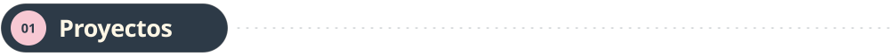

<a href="https://in2u.vercel.app/"></a>

<table>
  <tr>
    <td width="50%" valign="top"><a href="https://github.com/melware-labs/tormenta"></a></td>
    <td width="50%" valign="top"><a href="https://melany-martinez.vercel.app/">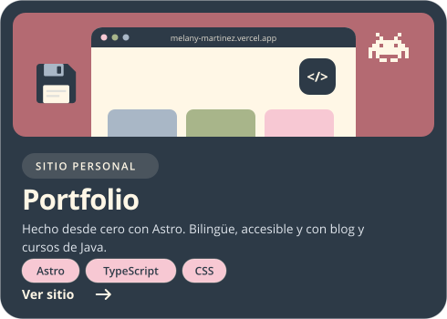</a></td>
  </tr>
</table>

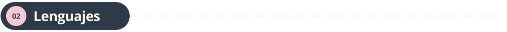

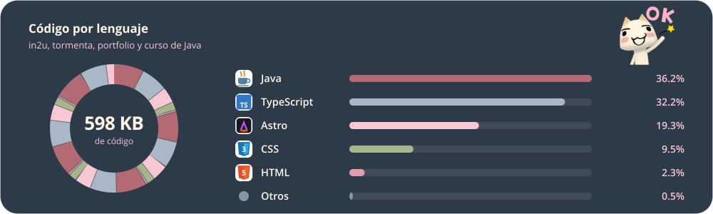







<table>
  <tr>
    <td width="33%" valign="top"><a href="https://www.linkedin.com/in/programadora-melany-martinez/">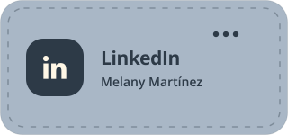</a></td>
    <td width="33%" valign="top"><a href="https://www.instagram.com/ravenmel.9/"></a></td>
    <td width="33%" valign="top"><a href="https://www.tiktok.com/@ravenmel.9"></a></td>
  </tr>
</table>


<a href="https://melany-martinez.vercel.app/#contacto">
  
</a>
